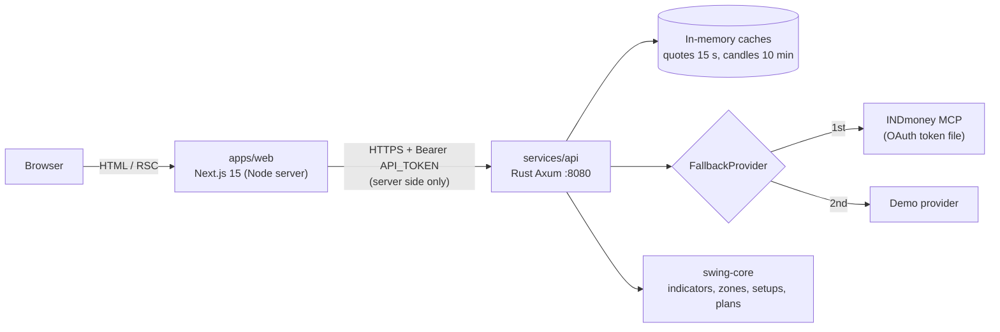

# swing-trade

A personal swing-trading web app for Indian stocks (NSE). It shows a watchlist with prices and sparklines, a chart page per stock with moving averages and support/resistance zones, and a suggested swing setup with entry, stop, target and position size.

It is **view and analysis only**. It never places orders, has no user accounts, and is built to run on free hosting first.

> **Disclaimer.** This is a personal analysis tool, not investment advice. Setups, scores and trade plans are mechanical outputs of simple rules and can be wrong. Market data can be delayed or incomplete. Do your own research and take responsibility for your own trades. Sharing its trade plans with other people may need SEBI research-analyst registration (see [ADR 0003](docs/decisions/0003-view-only-no-orders.md)).

## Features by phase

| Phase | What you get |
|---|---|
| **1. List & chart MVP** (current) | Watchlist table with price, change, 52-week range and 30-day sparkline. Stock page with daily/weekly/15-minute candles, SMA 20/50/200, RSI, ATR and support/resistance zones. Each stock gets its best setup (if any) with a trade plan. Data from INDmoney (MCP, OAuth) with a built-in demo provider as fallback. |
| 2. Swing engine | Full scanner over the four presets (pullback, breakout, support bounce, oversold) with the 0-100 score, reasons and position sizing from your capital and risk. |
| 3. Data | Nightly Nifty 500 sync, Postgres + TimescaleDB for history, CSV import of fundamentals for the quality score. |
| 4. News & AI | News per stock and an AI gateway (OpenAI-compatible, native Claude/Gemini, local Ollama/LM Studio) with per-job routing and spend caps. |
| 5. Live & journal | Live ticks via Kite Connect, a trade journal and backtests. |

Details: [docs/roadmap.md](docs/roadmap.md).

## Architecture



The browser only ever talks to the Next.js server. The Next.js server calls the Rust API with the shared `API_TOKEN`, so the token never reaches the browser. The API fetches quotes and candles from the configured providers (first one that answers wins), caches them in memory and runs the swing engine on them. More in [docs/architecture.md](docs/architecture.md) and the API contract in [docs/api.md](docs/api.md).

## Repository layout

```
swing-trade/
├── apps/
│   └── web/                  Next.js 15 front end (npm, standalone output)
├── services/
│   └── api/                  Rust workspace
│       ├── crates/
│       │   ├── swing-core/   pure analytics: indicators, zones, setups, trade plans
│       │   ├── market-data/  MarketData trait + INDmoney MCP and demo connectors
│       │   └── api-server/   Axum HTTP server, binary `swing-api`
│       └── Dockerfile
├── docs/                     architecture, API, configuration, deployment, roadmap, ADRs
├── scripts/                  dev.sh / dev.ps1 (start API + web together)
├── .github/                  CI and Dependabot
├── docker-compose.yml
├── Makefile
└── .env.example
```

Python is not used yet. A `services/quant` folder will be added later only if an analytics library needs Python.

## Quick start

### Prerequisites

- [Rust](https://rustup.rs/) stable (1.82 or newer)
- [Node.js](https://nodejs.org/) 20 or newer, with npm
- Optional: Docker Desktop (or Docker Engine with Compose v2)

### 1. Configure

```bash
cp .env.example .env
openssl rand -hex 32        # paste the output into API_TOKEN in .env
```

No INDmoney account? Set `DATA_PROVIDERS=demo` in `.env` (see [Demo mode](#demo-mode)).

### 2. Run the API

```bash
cd services/api
cargo run -p api-server -- serve        # http://localhost:8080/health
```

### 3. Log in to INDmoney (once, skip in demo mode)

```bash
cd services/api
cargo run -p api-server -- login indmoney
```

This runs the OAuth login and saves the token to `INDMONEY_TOKEN_FILE` (by default `services/api/.data/indmoney-token.json` when run from `services/api`).

### 4. Run the web app

The Next.js server needs `API_URL` and `API_TOKEN`. The scripts and `make` targets export them from the root `.env`; if you run `npm` by hand, either export them in your shell or put them in `apps/web/.env.local`.

```bash
cd apps/web
npm install
npm run dev                              # http://localhost:3000
```

Or start both at once: `./scripts/dev.sh`, or `make dev-api` and `make dev-web` in two terminals.

### Or with Docker

```bash
docker compose up --build
```

Web on <http://localhost:3000>, API on <http://localhost:8080>. The INDmoney token lives in `./.data/` (mounted at `/app/.data`). To reuse a token you got with `cargo run ... login indmoney`, copy `services/api/.data/indmoney-token.json` into `./.data/`. On Linux, make the folder writable for the container user first: `mkdir -p .data && sudo chown 10001 .data`.

### Windows notes

Use PowerShell from the repo root. `make` is not needed.

```powershell
Copy-Item .env.example .env

# Generate a 32-byte hex token (crypto RNG) and paste it into API_TOKEN in .env
$b = New-Object byte[] 32; [Security.Cryptography.RandomNumberGenerator]::Create().GetBytes($b); -join ($b | ForEach-Object { '{0:x2}' -f $_ })

# Start API and web in two windows (loads .env for both)
powershell -ExecutionPolicy Bypass -File scripts\dev.ps1

# INDmoney login (once)
cd services\api; cargo run -p api-server -- login indmoney
```

- If you run the web app by hand, set the variables first: `$env:API_URL = "http://localhost:8080"; $env:API_TOKEN = "<your token>"`, then `npm run dev` in `apps\web`.
- `.gitattributes` keeps `.ps1` files in CRLF and everything else in LF, so line endings stay consistent between Windows and CI.
- Docker Desktop with the WSL 2 backend runs `docker compose up --build` as is.

## Configuration

All settings are environment variables, read from `.env` at the repo root. Full reference: [docs/configuration.md](docs/configuration.md).

| Variable | Default | Used by | Purpose |
|---|---|---|---|
| `BIND_ADDR` | `0.0.0.0:8080` | API | Listen address |
| `API_TOKEN` | *(required)* | API, web | Bearer token for `/v1/*` |
| `ALLOW_NO_TOKEN` | `false` | API | Allow running without `API_TOKEN` (local only) |
| `DATA_PROVIDERS` | `indmoney,demo` | API | Providers in fallback order |
| `INDMONEY_MCP_URL` | `https://mcp.indmoney.com/mcp` | API | INDmoney MCP endpoint |
| `INDMONEY_TOKEN_FILE` | `.data/indmoney-token.json` | API | Saved OAuth token |
| `INDMONEY_ACCESS_TOKEN` | *(empty)* | API | Use this token instead of the file |
| `CORS_ORIGINS` | `http://localhost:3000` | API | Allowed browser origins |
| `WATCHLIST` | `COFORGE,MCX,CAMS,IEX,ACE,AJAXENGG,ASKAUTOLTD,PERSISTENT,OFSS,BSE` | API | Default symbols |
| `DEFAULT_CAPITAL` | `500000` | API | Capital for position sizing (Rs) |
| `DEFAULT_RISK` | `0.01` | API | Risk per trade as a fraction |
| `QUOTE_TTL_SECS` | `15` | API | Quote cache lifetime |
| `CANDLE_TTL_SECS` | `600` | API | Candle cache lifetime |
| `RUST_LOG` | `info` | API | Log filter |
| `LOG_FORMAT` | `pretty` | API | `pretty` for local dev, `json` for servers |
| `API_URL` | `http://localhost:8080` | web | Where the web server reaches the API |
| `NEXT_PUBLIC_APP_NAME` | `Swing Trade` | web | App name (baked in at build time) |

## Demo mode

Set `DATA_PROVIDERS=demo` to run with generated sample data and no account at all. Everything works the same (list, charts, setups), but the prices are not real. With the default `indmoney,demo`, the demo provider also acts as a fallback when INDmoney is not logged in or not reachable; the `provider` field in every API response tells you which source answered.

## Testing and linting

```bash
make test     # cargo test + npm run typecheck + npm run lint
make lint     # cargo fmt --check, cargo clippy -D warnings, npm run lint
make fmt      # cargo fmt
make build    # release API binary + Next.js production build
```

Without `make` (e.g. Windows):

```powershell
cd services\api
cargo fmt --all -- --check
cargo clippy --workspace --all-targets -- -D warnings
cargo test --workspace

cd ..\..\apps\web
npm run lint
npm run typecheck
npm run build
```

CI runs the same checks on every push and pull request ([.github/workflows/ci.yml](.github/workflows/ci.yml)).

## Free hosting

| Part | Free option | Notes |
|---|---|---|
| Web | Vercel Hobby | Set `API_URL`, `API_TOKEN`, `NEXT_PUBLIC_APP_NAME` in project settings, root directory `apps/web` |
| API | Oracle Cloud Always Free ARM VM (2 OCPU / 12 GB) | `docker compose up -d api` behind HTTPS |
| API (alt) | Your own laptop + Cloudflare Tunnel | Free HTTPS hostname, no open ports |

Later, paid: AWS Lightsail (Mumbai) at about $12-24/month with Docker Compose + Caddy. Step by step: [docs/deployment.md](docs/deployment.md).

## Security notes

- There is no login. **`API_TOKEN` is the only thing protecting the API.** Use a long random value, keep it out of git, and never expose the API to the internet without it. Do not set `ALLOW_NO_TOKEN=true` outside your own machine.
- Never put the token in a `NEXT_PUBLIC_*` variable; those are shipped to the browser.
- The INDmoney token file (`.data/`) grants access to your INDmoney data. It is git-ignored; keep it that way and don't copy it anywhere public.
- The deployed web app has no login either, so anyone with its URL can view it. Keep the URL to yourself.
- Report vulnerabilities privately, see [SECURITY.md](SECURITY.md).

## Roadmap

See [docs/roadmap.md](docs/roadmap.md) and the decision records in [docs/decisions/](docs/decisions/).

## Contributing

See [CONTRIBUTING.md](CONTRIBUTING.md).

## License

[MIT](LICENSE) © 2026 selvarajpownu
