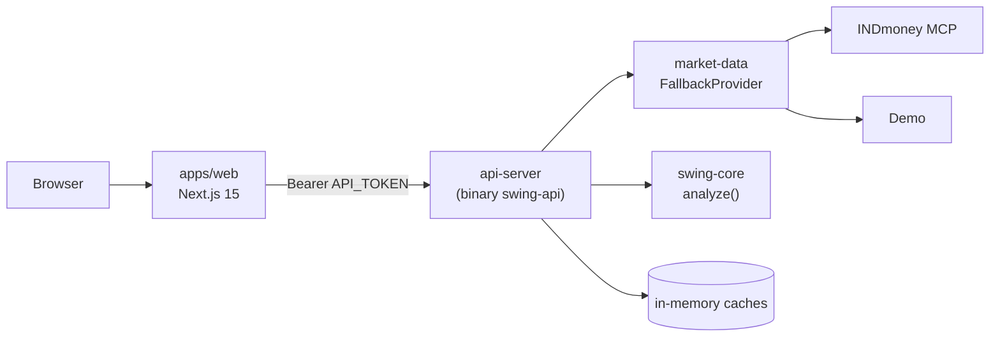

# Architecture

Phase 1 runs as two processes and no database.



## Components

| Component | Path | Role |
|---|---|---|
| Web | `apps/web` | Next.js 15 (App Router), `output: "standalone"`. Renders pages on the server and calls the API from server components / route handlers using `API_URL` + `API_TOKEN`. The browser never sees the token or calls the API directly. |
| API server | `services/api/crates/api-server` | Axum HTTP server, binary `swing-api`. Subcommands: `serve` (default) and `login indmoney`. Checks the bearer token, caches data, calls the swing engine, returns JSON as described in [api.md](api.md). |
| Market data | `services/api/crates/market-data` | The `MarketData` trait and its connectors (INDmoney MCP, demo), plus `FallbackProvider`. |
| Swing core | `services/api/crates/swing-core` | Pure maths over candles with no dependencies and no I/O: indicators, support/resistance zones, setup presets, score and trade plan. The same code will serve scans and backtests later. |

## Data flow (stock page)

1. Browser requests `/stocks/COFORGE` from the Next.js server.
2. Next.js calls `GET /v1/stocks/COFORGE?interval=1d` on the API with `Authorization: Bearer <API_TOKEN>`.
3. The API returns cached quote/candles if still fresh (`QUOTE_TTL_SECS`, `CANDLE_TTL_SECS`), otherwise asks the `FallbackProvider`.
4. The `FallbackProvider` tries each provider in `DATA_PROVIDERS` order and uses the first that succeeds. The response's `provider` field names it.
5. `swing_core::analyze` computes SMAs, RSI, ATR, zones and the best setup with its trade plan, sized with the request's `capital` and `risk` (defaults `DEFAULT_CAPITAL`, `DEFAULT_RISK`).
6. The API returns JSON; Next.js renders the page.

## Connector interface

```rust
#[async_trait]
pub trait MarketData: Send + Sync {
    fn id(&self) -> &'static str;                       // "indmoney", "demo"
    async fn quotes(&self, symbols: &[String]) -> Result<Vec<Quote>>;   // unknown symbols skipped
    async fn candles(&self, symbol: &str, interval: Interval) -> Result<Vec<Candle>>; // oldest first
}
```

- **INDmoney** talks to the INDmoney MCP server (`INDMONEY_MCP_URL`) with an OAuth access token. `swing-api login indmoney` runs the login once and stores the token in `INDMONEY_TOKEN_FILE`; `INDMONEY_ACCESS_TOKEN` overrides the file.
- **Demo** generates sample data so the app works with no account. Prices are not real.
- Adding a source (e.g. Kite Connect in phase 5) means one new type implementing the trait and one new id in `DATA_PROVIDERS`. See [ADR 0004](decisions/0004-pluggable-market-data.md).

## Swing engine

### Presets

| Preset | Fires when |
|---|---|
| Pullback | Uptrend, price back near the 20/50-day average, RSI cooled off |
| Breakout | Close above the 55-day high on heavy volume |
| Support bounce | Price at a support zone with a bullish reversal bar |
| Oversold | RSI(14) under 30 (meant for quality stocks only) |

All presets are evaluated on the latest bar and the highest-scoring hit is kept. Support/resistance zones come from swing highs/lows (5 bars each side) merged when closer than 0.5 ATR.

### Score (0-100)

| Part | Max points |
|---|---|
| Trend | 30 |
| Closeness to the entry area | 30 |
| Volume | 15 |
| Risk-reward | 15 |
| Quality (fundamentals) | 10 |

Quality stays 0 until the CSV fundamentals import arrives (phase 3). Each setup also carries plain-language `reasons`.

### Trade plan (long only)

- **Entry:** just above the setup bar's high (high + 0.1%), rounded to the Rs 0.05 tick.
- **Stop:** just below the nearest support zone, but at least 1 ATR(14) below entry; if there is no support far enough away, entry − 1 ATR.
- **Target:** the next resistance zone if it is at least 1R away, otherwise entry + 2R.
- **Quantity:** `floor(capital × risk ÷ (entry − stop))`.
- Plans with risk-reward below 2.0 are returned with state `low_risk_reward` (shown greyed out); others are `watching`.

## State and storage

- Phase 1: in-memory caches only. Restarting the API clears them. The only file on disk is the INDmoney token in `.data/`.
- Phase 3: Postgres + TimescaleDB for candle history, nightly Nifty 500 sync and fundamentals. The commented `db` service in `docker-compose.yml` shows where it goes.
- Python (`services/quant`) is not created yet; it will be added only if a needed analytics library exists only in Python.

## Security model

No user accounts. The API trusts any caller holding `API_TOKEN` and rejects everything else on `/v1/*`; `/health` is open. See [ADR 0002](decisions/0002-no-login-token-auth.md). The app never places orders: [ADR 0003](decisions/0003-view-only-no-orders.md).
