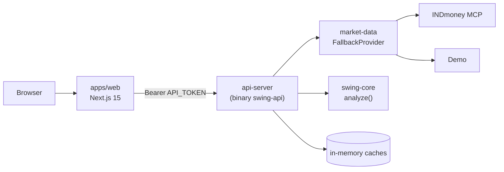

# Architecture

Phase 1 runs as two processes and no database.



## Components

| Component | Path | Role |
|---|---|---|
| Web | `apps/web` | Next.js 15 (App Router), `output: "standalone"`. Renders pages on the server and calls the API from server components / route handlers using `API_URL` + `API_TOKEN`. The browser never sees the token or calls the API directly. |
| API server | `services/api/crates/api-server` | Axum HTTP server, binary `swing-api`. Subcommands: `serve` (default) and `login indmoney`. Checks the bearer token, caches data, calls the swing engine, returns JSON as described in [api.md](api.md). |
| Market data | `services/api/crates/market-data` | The `MarketData` trait and its connectors (INDmoney MCP, demo), plus `FallbackProvider`. |
| Swing core | `services/api/crates/swing-core` | Pure maths over candles with no dependencies and no I/O: indicators, support/resistance zones, setup presets, score and trade plan. The same code will serve scans and backtests later. |

## Data flow (stock page)

1. Browser requests `/stocks/COFORGE` from the Next.js server.
2. Next.js calls `GET /v1/stocks/COFORGE?interval=1d` on the API with `Authorization: Bearer <API_TOKEN>`.
3. The API returns cached quote/candles if still fresh (`QUOTE_TTL_SECS`, `CANDLE_TTL_SECS`), otherwise asks the `FallbackProvider`.
4. The `FallbackProvider` tries each provider in `DATA_PROVIDERS` order (default `yahoo,indmoney,nse,demo`) and uses the first that succeeds. The response's `provider` field names it. A provider that does not cover the request (`Unsupported`, e.g. Yahoo for MCX) is skipped quietly; "symbol not found" from a real provider is final.
5. `swing_core::analyze` computes SMAs, RSI, ATR, zones and the best setup with its trade plan, sized with the request's `capital` and `risk` (defaults `DEFAULT_CAPITAL`, `DEFAULT_RISK`).
6. The API returns JSON; Next.js renders the page.

## Connector interface

```rust
#[async_trait]
pub trait MarketData: Send + Sync {
    fn id(&self) -> &'static str;                       // "indmoney", "demo"
    async fn quotes(&self, symbols: &[String]) -> Result<Vec<Quote>>;   // unknown symbols skipped
    async fn candles(&self, symbol: &str, interval: Interval) -> Result<Vec<Candle>>; // oldest first
}
```

- **Yahoo** (`market-data/src/yahoo.rs`) calls Yahoo Finance's public chart endpoint: one request per symbol returns the quote and the bars (daily for a year, or 15-minute for five days), cached 30 seconds and rate limited. NSE symbols get `.NS`; US tickers are used as they are; MCX is not covered. No account. Unofficial, so it sits in front of INDmoney rather than replacing it.
- **NSE files as a provider** (`NseEodProvider`): daily and weekly candles and end-of-day quotes for the scan universe from the cached NSE files; the last real fallback before demo.
- **INDmoney** talks to the INDmoney MCP server (`INDMONEY_MCP_URL`) with an OAuth access token. `swing-api login indmoney` runs the login once and stores the token in `INDMONEY_TOKEN_FILE`; `INDMONEY_ACCESS_TOKEN` overrides the file.
- **Markets:** `market=in|us|mcx` on the stock routes. Providers receive market-qualified keys (`ACE`, `US:AAPL`,
  `MCX:GOLD`; see `Market::key`). US data comes from INDmoney's US tools (daily candles only; weekly is aggregated,
  15m is refused). MCX symbols resolve to the near-month future (`lookup_ind_keys` with `IN_COMMODITY`, cached 6 h).
- **INDmoney rate limits:** 60 cost units per minute **and 500 per hour** across all tools (OHLC costs 2). A throttled call returns `{"error":"rate_limit_exceeded","retry_after_seconds":N,...}`; the provider waits and retries when N ≤ 5 s (twice at most), otherwise it fails with `Upstream` and the fallback answers. Login requests only the read scopes INDmoney advertises (write scopes such as `insights:write` are dropped). A call never waits more than 8 s for budget: it fails with
  `RateLimited` instead, so pages answer promptly, while the scanner waits and retries.
- **Demo** generates sample data so the app works with no account. Prices are not real.
- **Caching across providers:** candles from real providers are cached for `CANDLE_TTL_SECS`; demo candles served because every real provider failed are cached only for `QUOTE_TTL_SECS`, so real data returns quickly after a hiccup.
- Adding a source (e.g. Kite Connect in phase 5) means one new type implementing the trait and one new id in `DATA_PROVIDERS`. See [ADR 0004](decisions/0004-pluggable-market-data.md).

## Swing engine

### Presets

| Preset | Fires when |
|---|---|
| Pullback | Uptrend, price back near the 20/50-day average, RSI cooled off |
| Breakout | Close above the 55-day high on heavy volume |
| Support bounce | Price at a support zone with a bullish reversal bar |
| Oversold | RSI(14) under 30 (meant for quality stocks only) |

All presets are evaluated on the latest bar and the highest-scoring hit is kept. Support/resistance zones come from swing highs/lows (5 bars each side) merged when closer than 0.5 ATR.

### Score (0-100)

| Part | Max points |
|---|---|
| Trend | 30 |
| Closeness to the entry area | 30 |
| Volume | 15 |
| Risk-reward | 15 |
| Quality (fundamentals) | 10 |

Quality stays 0 until the CSV fundamentals import arrives (phase 3). Each setup also carries plain-language `reasons`.

### Trade plan (long only)

- **Entry:** just above the setup bar's high (high + 0.1%), rounded to the Rs 0.05 tick.
- **Stop:** just below the nearest support zone, but at least 1 ATR(14) below entry; if there is no support far enough away, entry − 1 ATR.
- **Target:** the next resistance zone if it is at least 1R away, otherwise entry + 2R.
- **Quantity:** `floor(capital × risk ÷ (entry − stop))`.
- Plans with risk-reward below 2.0 are returned with state `low_risk_reward` (shown greyed out); others are `watching`.

## Background scanner (phase 2)

`GET /v1/scan` reads results kept in memory by a background task (`api-server/src/scan.rs`):

1. The universe comes from `UNIVERSE_FILE`, `UNIVERSE` or `WATCHLIST` (`universe.rs`). `INDRAMEDCO` is always excluded.
2. For each symbol the scanner loads daily candles from the file store (`store.rs`, `CANDLE_STORE_DIR`) when they are
   fresh for the current session, otherwise fetches them from the **primary** provider only, paced at
   `SCAN_SYMBOLS_PER_MIN`. A scan never falls back to demo.
3. `swing_core::analyze` returns every preset that fires (`Analysis::setups`); stocks with at least one are kept.
4. Results replace the previous scan's when the run finishes; the next run starts after `SCAN_INTERVAL_MINS`.

The INDmoney provider's rate limiter (`market-data/src/rate.rs`) is shared by the scanner and page requests, so a
running scan slows pages down slightly rather than tripping INDmoney's limit.

## NSE end-of-day data and the swing screen

With `NSE_EOD` (default for real data) the scanner does not ask the provider for daily candles. `market-data/src/nse.rs`
keeps `NSE_EOD_DAYS` sessions of NSE's public files:

- **Full bhavcopy** (`sec_bhavdata_full_DDMMYYYY.csv`): OHLC, volume and delivery % for every stock. On a holiday the
  archive re-serves the previous session's file, so the date inside the file decides; weekend special sessions
  (Diwali Muhurat) exist, so every calendar day is tried. `.none` markers remember days without a session.
- **Index closes** (`ind_close_all_DDMMYYYY.csv`): Nifty 50 for the market regime.
- **Corporate actions** (NSE API, refreshed daily): bhavcopy prices are unadjusted, so bonuses and splits are applied
  from this list when the ex-date price gap agrees with the listed ratio. NSE's own adjusted previous close catches
  consolidations, demergers use the observed gap, and an unlisted gap beyond −28% / +45% is treated as an action.
  Dividends are not adjusted. Adjusted closes matched INDmoney's candles on 140 of 140 stocks checked (Nov 2026).

**Catalysts** (`market-data/src/nse_events.rs`, refreshed before each scan, each source on its own interval of 1 to
12 hours): board meetings (results dates), corporate actions (ex-dates), announcements (only the categories NSE tags
as order wins, capacity, acquisitions, credit ratings, resignations, regulatory or legal matters, exchange queries,
stake disclosures and fund raising; fetched incrementally), bulk and block deals, the ASM and GSM surveillance lists
and the F&O ban list. A failing source keeps its last saved copy and is reported in `status.catalyst_errors`.
Results dates feed the results-gap setup, surveillance fails the tradable gate, and every stock carries its events
for the swing table and the stock page's Filings tab (`GET /v1/stocks/{symbol}/events`). NSE's insider-trading API
returned nothing when probed, so insider trades are not included.

Each scan then runs `swing_core::screen` over the whole universe at once (relative-strength rank, breadth, sector
strength, gates, breakout and pullback setups) and keeps the result for `GET /v1/swing`. A 503-stock scan takes
about 2 seconds and spends no INDmoney budget; INDmoney stays in use for quotes, charts and news.

## State and storage

- In-memory caches; restarting the API clears them. On disk in `.data/`: the INDmoney token, the cached NSE files (`nse/`), the universe file and (when `NSE_EOD=false`) the scanner's daily-candle store.
- Phase 3: Postgres + TimescaleDB for candle history, nightly Nifty 500 sync and fundamentals. The commented `db` service in `docker-compose.yml` shows where it goes.
- Python (`services/quant`) is not created yet; it will be added only if a needed analytics library exists only in Python.

## Security model

No user accounts. The API trusts any caller holding `API_TOKEN` and rejects everything else on `/v1/*`; `/health` is open. See [ADR 0002](decisions/0002-no-login-token-auth.md). The app never places orders: [ADR 0003](decisions/0003-view-only-no-orders.md).
